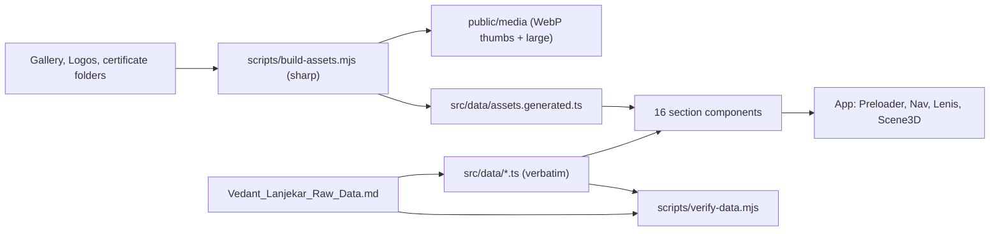

# Vedant Lanjekar Portfolio: Build Plan

## What the audit found

- **No existing app.** The folder contains content and assets only, so the project will be set up from scratch in `Por/`.
- **The content source** is [Vedant_Lanjekar_Raw_Data.md](Vedant_Lanjekar_Raw_Data.md), 2577 lines. The `.docx` file is the same content.
- **Assets:**
  - `Gallery/` has 60 photos (about 88 MB of JPG/JPEG).
  - `Logos/` has logos for Valmet, Bharat Electrical, DYPCOEI (jpeg and webp), New Horizon, The Indian School and Acmegrade.
  - Certificates are in six folders: `Workshop & Course Certificates/` (10), `Hackathon, Ideathon, Project Exibition, Conference Certificates/` (26), `Internship Certificates/` (4 certificates plus 2 Valmet letters), `Social Activity Certificates/` (7), `Student Council/` (3) and `Educational Certificates/` (6).
  - `Hero Section.png` is a dark studio portrait and will be the hero image. `Vedant Lanjekar.jpg` is a white-background portrait for the profile section and the social-sharing image.
- **Missing logos:** Mood Indigo, IIT Bombay, DYPIMED and DYPTC. These will be shown as clean text wordmarks, not recreated logos.
- **Data quirks kept as written:**
  - Project number 4.11 does not exist.
  - CLIMETRYX reuses the domains, role and stack text from SENTIVIEW and PROLINK HUB.
  - Some dates are written unusually, for example "January 2024 – march 2024" and "June 2024 July 2024".

## Your decisions

- **Notes:** Author-facing editorial notes are left out. The co-founder confirmation notes for BuildWyse and Stack Notes are kept. Every `?utm_source=chatgpt.com` suffix is removed from links; the base URLs stay unchanged.
- **Certificates:** Every certificate image in every folder is shown, including the marksheets and the Valmet letters.

## Stack

- Vite, React 18 and TypeScript.
- Plain CSS built on design tokens, with one CSS Module per component. This gives full control over the editorial layout without template styling.
- `three`, `@react-three/fiber` and `@react-three/drei` for 3D. These are lazy-loaded, and there is a fallback when WebGL isn't available.
- `gsap` with ScrollTrigger for animation tied to scroll position, and `lenis` for smooth scrolling.
- `motion` for component transitions such as the modal viewers and expanding sections.
- `react-icons` for technology and platform logos: Simple Icons first, then Font Awesome for LinkedIn. Technologies without a logo get a monospaced text wordmark.
- `lucide-react` for interface icons.
- `sharp`, as a dev dependency only, for the asset pipeline.

## Architecture

- **Original files are never touched.** `scripts/build-assets.mjs` reads the source folders and writes WebP copies to `public/media/<category>/` at two sizes, about 640px wide for thumbnails and about 2000px wide for the viewer. It also writes a manifest with each image's width, height and aspect ratio. The script runs as `predev` and `prebuild`.
- **`docs/asset-map.md`** records each asset's filename, original location, category, portfolio section, related project or organization, and where it is displayed.
- **Data files:** `src/data/` contains `profile.ts`, `education.ts`, `skills.ts`, `projects.ts`, `research.ts`, `ventures.ts`, `experience.ts`, `certifications.ts`, `achievements.ts`, `leadership.ts`, `strengths.ts`, `languages.ts`, `interests.ts`, `contact.ts` and `references.ts`. All text is copied word-for-word.
- **Certificate mapping:** I'll look at each certificate image during the build and link it to its matching entry: a certification, an achievement, an experience, a leadership role or an education record. Images that can't be matched with confidence go into a labelled archive under the relevant section. Nothing is guessed.
- **Components** follow the structure suggested in the brief:
  - `layout/`: Preloader, Navigation, SectionWrapper, Footer.
  - `hero/`: hero section components.
  - `three/`: HeroScene and BackgroundScene.
  - `interactions/`: CustomCursor, MagneticLink, Reveal, ScrollProgress.
  - `sections/`: one component per section.
  - `projects/`, `gallery/`, `certificates/`: the project index, gallery and certificate viewer.
- **Hooks:** `useReducedMotion`, `useActiveSection` and `usePointer`. `usePointer` stores pointer position in a ref and reads it inside requestAnimationFrame, so moving the mouse doesn't trigger React re-renders.

## Design system

- **Colours** from the brief: graphite `#0B0F12` and `#151B20`, ivory `#F2F2ED`, cool grey `#A4ADB5`, mint `#80E3C5` used sparingly, and silver `#7D8790`. Borders are hairlines at 8–12% opacity. A fine film-grain overlay and a faint technical grid add texture.
- **Typography:** Space Grotesk for headings, Inter for body text and IBM Plex Mono for metadata. Fonts are self-hosted with `@fontsource` and use `font-display: swap`. Sizes scale smoothly with screen width using `clamp()`, and line length is capped at about 68 characters.
- **Layout:** asymmetric editorial grids, section numbers set in mono (01–16), and a different layout for each section so pages don't repeat.

## Section by section

- **Preloader:** shows "Build with Vedant Lanjekar" letter by letter over a grid, with a wireframe icosahedron and a thin line that fills with real asset-loading progress. The text then expands and a clip-path mask reveals the hero. It lasts at most about 2.2 seconds. With reduced motion turned on, it simply fades.
- **Hero:**
  - The name, headline and tagline sit on the left, word for word.
  - `Hero Section.png` sits on the right and is masked into the graphite background.
  - A 3D network of nodes and edges (instanced points plus line segments) responds to the cursor and scrolling.
  - Elements enter in sequence as the brief describes, and a scroll indicator sits at the bottom.
- **01 Profile:** the summary as an editorial lead paragraph, followed by the 8 focus domains as a numbered index.
- **02 Education:** a vertical timeline. The SGPA table is rendered as a readable table with a bar for each semester using the exact values; no new figures are calculated. School logos and marksheets open in the viewer.
- **03 Skills:** 14 category rows, each with a logo-and-name strip that moves slowly and pauses on hover. Each row can be expanded to show the full list.
- **04 Projects:**
  - A large numbered index using the original numbers 4.1–4.10 and 4.12–4.20. Hovering a row shows a preview that follows the cursor.
  - Clicking a row opens a full-screen detail panel with every field: duration, domains, role, overview, vision, mission, objectives, stack, publication details, repository and live links.
  - AIVORA Labs gets an interactive node map of its seven apps around a central hub. Each app opens its own vision, mission, objectives and links.
- **05 Research:** laid out like an academic index, with publication metadata (ISSN, volume, issue, year, pages) in mono.
- **06 Ventures:** each venture shows a stage badge (Ideation Stage, Founder-Led, Collaborative). It includes the BuildWyse modules and lifecycle, the Stack Notes knowledge areas, and the co-founder confirmation notes.
- **07 Experience:** a career timeline with the real logos. All 8 Valmet applications are listed, plus manager contacts. The internship certificates and Valmet letters open in the viewer.
- **08 Certifications:** an index of all 10 entries matched to their certificate images. A lightbox shows each certificate whole, with zoom and no cropping.
- **09 Achievements:** "₹1,54,500+" in large type, then three groups (2026, 2025, Additional) as editorial rows showing level, position, organizer and project. The matching hackathon certificates are linked from their rows.
- **10 Leadership:** a timeline with the student council and social activity certificates.
- **11 Strengths:** a ten-item editorial list, kept unmerged.
- **12 Languages:** three entries with the exact proficiency wording.
- **13 Interests:** all six interests, with the Seasons of Love book link.
- **14 Gallery:**
  - Three or four horizontal tracks moving in alternating directions, sized to each photo's aspect ratio and built from all 60 photos.
  - Scroll speed adjusts the movement, the cursor adds parallax, and hovering slows the track.
  - Clicking a photo opens a keyboard-accessible viewer showing "N of 60".
  - There's a pause control. On mobile the tracks can be swiped and use fewer layers.
- **15 Contact:** email, phone and location with copy-to-clipboard, and all 6 profiles with platform logos. LinkedIn, GitHub and Instagram link to real URLs. Freelancer links to `freelancer.com/u/vedantl00`. The LeetCode and Microsoft Learn IDs are shown with a copy button, because the source gives IDs rather than profile URLs.
- **16 References:** three references with their details exactly as written.
- **Navigation:** a slim fixed bar with a compact menu that expands to all 16 sections. The active section is highlighted, there's a scroll-progress line and a skip link, and on mobile it becomes a full-screen menu.

## Motion, cursor and 3D

- **Scroll animation:** one GSAP timeline per section (text reveals, timeline progress, image parallax), driven by Lenis and ScrollTrigger.
- **Background:** a 3D scene with layered depth. A wireframe grid, a node field and slow-moving forms change camera position and tint by section. Opacity stays low so text keeps its contrast.
- **Custom cursor:** a dot and ring, used only on devices with a precise pointer that supports hover. It has `pointer-events: none` and grows over links. Magnetic buttons pull toward the cursor by about 6px at most.
- **Reduced motion:** turns off the marquee tracks, parallax and 3D animation. The scene stays still, and all content remains readable.

## SEO, accessibility and performance

- **SEO:** the page title from the brief, a meta description built from the existing positioning text, Open Graph and Twitter tags, a favicon with the initials "VL", and an OG image made from `Vedant Lanjekar.jpg`.
- **Accessibility:** semantic sections with IDs (`#profile`, `#projects` and so on), modals that trap focus and close with Esc, visible focus rings, alt text taken from the asset map, and `rel="noopener noreferrer"` on external links.
- **Performance:** the 3D canvas and gallery load lazily, images use `loading="lazy"`, `decoding="async"` and `srcset`, the 3D pixel ratio is capped at 1.5 and lowered on mobile, and animation sticks to transforms and opacity.

## QA

- **`scripts/verify-data.mjs`** parses the source Markdown and checks that:
  - Every URL, with the utm suffix removed, appears in the data files.
  - All SGPA values, scores and dates match.
  - There are 19 projects, 28 achievements, 10 certifications, 5 leadership entries, 10 strengths and 3 references.
  - "₹1,54,500+" and every contact value match exactly.
- **Assets:** the manifest count must equal the number of source files, and there must be no broken paths.
- **Build:** `npm run build` and `npm run preview` must succeed with no console errors.
- **Visual check:** I'll check the built site in the browser at 1920, 1440, 1366, 1024, 768, 390 and 360px wide. That covers horizontal overflow, the preloader, navigation, project panels, gallery, certificate viewer and touch behaviour. Then I'll refine spacing and typography.
